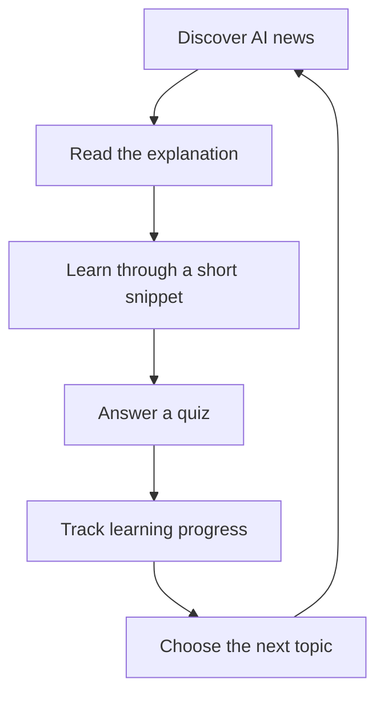
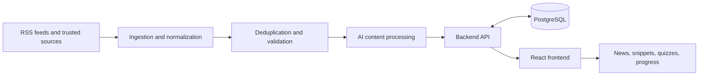

<div align="center">

# TokenTrail 🧭

### Follow the AI frontier. Understand what matters. Build knowledge that lasts.

**AI news, bite-sized insights, and structured learning — in one place.**

[](#roadmap)
[](#what-is-tokentrail)

</div>

---

## Table of Contents

- [What is TokenTrail?](#what-is-tokentrail)
- [The Problem](#the-problem)
- [The Approach](#the-approach)
- [Planned Features](#planned-features)
- [The Core Learning Loop](#the-core-learning-loop)
- [Proposed Technology Stack](#proposed-technology-stack)
- [Architecture](#architecture)
- [Getting Started](#getting-started)
- [Roadmap](#roadmap)
- [Design Principles](#design-principles)
- [Responsible AI and Content](#responsible-ai-and-content)
- [Contributing](#contributing)
- [License](#license)

## What is TokenTrail?

TokenTrail is an AI-powered knowledge and discovery platform designed to help people keep up with developments in artificial intelligence without feeling overwhelmed by the constant flow of information.

It brings together AI headlines, accessible explanations, short educational snippets, AI tools, and structured learning experiences. Instead of simply consuming updates, users can build context, test what they have learned, and follow their progress over time.

> **The idea:** turn staying updated on AI into a learning habit, not another endless news feed.

## The Problem

AI moves quickly. Important research, model releases, products, and industry developments appear across many different websites and platforms. Keeping up can become time-consuming, while technical explanations may be difficult for newcomers to understand.

TokenTrail aims to address three related challenges:

- **Information overload:** useful updates are scattered across sources.
- **Understanding gaps:** headlines do not always explain why a development matters.
- **Passive consumption:** reading about AI does not necessarily translate into retained knowledge.

## The Approach

TokenTrail is planned around a simple progression:

1. **Discover** relevant AI developments and tools.
2. **Understand** the context through clear explanations and bite-sized learning content.
3. **Practice** with questions and structured learning paths.
4. **Track** progress to see what has been explored and learned.

## Planned Features

The features below describe the intended product direction. Availability will depend on implementation progress.

### 📰 AI Headlines

A focused feed of AI news and developments, with source links and concise summaries to help users quickly understand what happened and why it matters.

### ⚡ AI Snippets

Short, approachable explanations of AI concepts, technologies, research, and terminology. The goal is to make complex topics easier to learn in small sessions.

### 📈 My Progress

A personal learning area for tracking completed topics, quiz results, learning activity, and progress through learning paths.

### 🧰 Explore AI

A discovery area for AI tools, models, platforms, and technologies, with useful descriptions to help users decide what to explore next.

### 🧭 Structured Learning

Topic-based learning paths and quizzes that help users move from awareness to understanding instead of jumping between unrelated posts.

### 🔭 Future Direction

Potential extensions include a conversational AI learning assistant, user profiles, community features, and creator-submitted snippets. These are future possibilities, not promises for the initial release.

## The Core Learning Loop



## Proposed Technology Stack

The stack below is a working proposal and should be updated to reflect the actual implementation as the project evolves.

| Layer | Proposed technologies | Purpose |
|---|---|---|
| Frontend | React, Vite, Tailwind CSS | Responsive user interface |
| Routing and API calls | React Router, Fetch or Axios | Navigation and backend communication |
| Backend | Python, FastAPI, Pydantic | API endpoints and application logic |
| Database | PostgreSQL, SQLAlchemy, Alembic | Persistent data and schema migrations |
| Content ingestion | Python, RSS feeds, HTTP clients, scheduled jobs | Collect and normalize source content |
| AI processing | LLM API or a locally hosted model | Summaries, explanations, and structured learning content |
| Testing | Pytest and API testing tools | Validate application behavior |
| Version control | Git and GitHub | Source control and collaboration |

Specific providers, models, and deployment services will be selected based on cost, reliability, data quality, and project requirements. The initial build should avoid unnecessary paid services.

## Architecture

The intended high-level flow is:



This is a conceptual architecture, not a claim that every component is already implemented.

## Getting Started

The repository is being developed incrementally. Until the application structure and setup scripts are in place, the commands below are a **proposed local setup**, not a guaranteed one-command installation.

### Prerequisites

- Git
- Node.js and npm
- Python 3.11 or a compatible version
- PostgreSQL, once database integration is added

### Clone the repository

```bash
git clone https://github.com/Saadkhan10412/TokenTrail.git
cd TokenTrail
```

### Next setup steps

As the frontend and backend are added, this section should be updated with the actual folder structure and exact commands to:

1. Install frontend dependencies.
2. Create and activate a Python virtual environment.
3. Install backend dependencies.
4. Configure environment variables.
5. Create the database and apply migrations.
6. Start the frontend and backend development servers.

Do not commit API keys, database passwords, access tokens, or other secrets. Keep local configuration in an untracked `.env` file and provide a sanitized `.env.example` for required variable names.

## Roadmap

The roadmap is intentionally focused on delivering a usable core experience before expanding the scope.

- [ ] Define the MVP scope and data model.
- [ ] Build the core frontend layout and navigation.
- [ ] Create the FastAPI backend and connect PostgreSQL.
- [ ] Implement source ingestion, normalization, and duplicate handling.
- [ ] Add AI-assisted summaries and explanations with source attribution.
- [ ] Build AI snippets and topic-based learning content.
- [ ] Add quizzes and basic learning-progress tracking.
- [ ] Test core flows and handle loading, empty, and error states.
- [ ] Deploy the MVP and document the real setup process.
- [ ] Evaluate future features such as recommendations, an AI assistant, and community contributions.

## Design Principles

TokenTrail aims for an editorial-tech experience rather than a generic analytics dashboard.

- **Readable first:** clear hierarchy, comfortable line lengths, and typography suited to long-form reading.
- **Calm visual language:** warm off-white surfaces, ink-colored text, and restrained emerald accents.
- **Useful over flashy:** motion and visual effects should serve comprehension, not distract from it.
- **Source-aware:** news and generated explanations should make it easy to trace information back to its source.
- **Progress over endless scrolling:** help users turn curiosity into deliberate learning.

## Responsible AI and Content

TokenTrail's content pipeline should be designed to:

- Keep links to original sources and clearly distinguish summaries from source material.
- Treat AI-generated explanations as assistance, not infallible fact.
- Validate structured model outputs before storing or displaying them.
- Handle duplicate, outdated, and low-quality content.
- Respect source terms, copyright, rate limits, and applicable API policies.
- Avoid exposing secrets or personal data in logs and prompts.

## Contributing

TokenTrail is an evolving project. Contributions, feedback, bug reports, and suggestions are welcome.

If you want to contribute:

1. Open an issue describing the proposed change or problem.
2. Keep changes focused and explain the reasoning.
3. Test the affected flow before submitting a pull request.
4. Update documentation when behavior or setup instructions change.

## License

No license has been specified yet. Until a license is added to the repository, do not assume that the code is available for unrestricted reuse. Add a `LICENSE` file when the intended terms are decided.

---

<div align="center">

**TokenTrail — Stay curious. Keep learning. Follow the trail.**

Built by [Saad Khan](https://github.com/Saadkhan10412)

</div>
